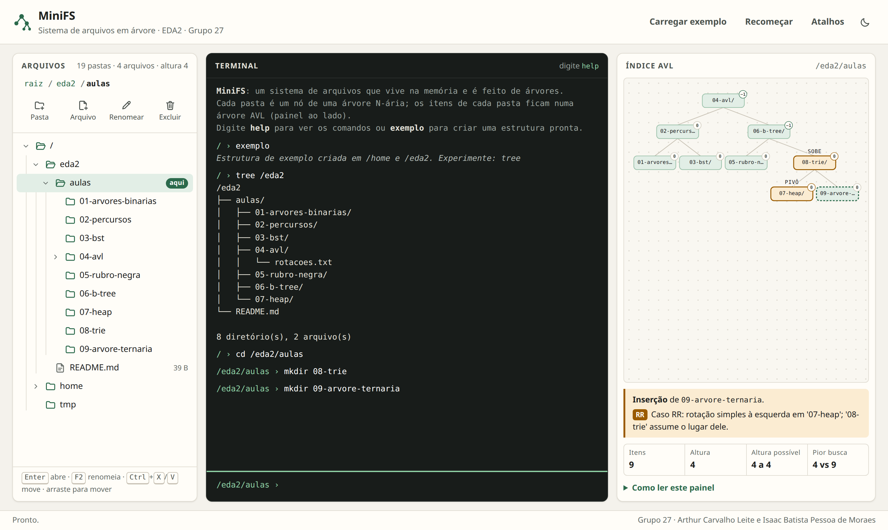
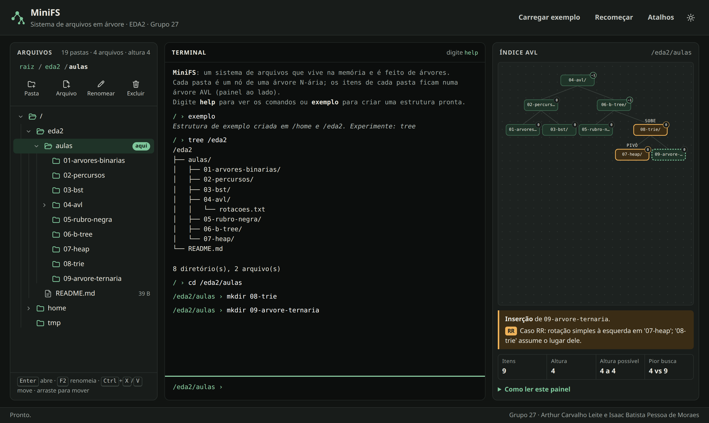

# MiniFS: sistema de arquivos em árvore

**Grupo 27 · Estruturas de Dados 2 · 2026.2 · Árvores**

- Arthur Carvalho Leite
- Isaac Batista Pessoa de Moraes

O MiniFS é um sistema de arquivos que vive inteiro na memória. Dá para criar pastas e arquivos, navegar, mover, copiar, buscar e apagar, tanto pelo **terminal** quanto por uma **interface web**. Por baixo, tudo é feito com árvores:

- a hierarquia de pastas é uma **árvore N-ária** (cada diretório é um nó e pode ter quantos filhos quiser);
- os itens de **cada pasta** ficam numa **árvore AVL** ordenada por nome, o que deixa buscar, criar e remover em O(log n) e faz o `ls` sair em ordem alfabética sem precisar ordenar;
- comandos como `tree`, `find`, `du`, `rm -r` e `cp -r` são, cada um, um **percurso de árvore** diferente.

A interface web mostra a AVL da pasta atual sendo desenhada e **anima as rotações** (LL, RR, LR e RL) quando elas acontecem.



<details>
<summary>Tema escuro</summary>



</details>

---

## Como rodar

Precisa de **Python 3.10+**. O terminal funciona sem instalar nada; a interface web precisa do Flask.

```bash
# Terminal (só biblioteca padrão)
python3 -m minifs

# Interface web: http://127.0.0.1:5000
python3 -m venv .venv
.venv/bin/pip install -r requirements.txt
.venv/bin/python -m minifs.web

# Testes
.venv/bin/python -m unittest discover -v
```

Com `make` os mesmos passos ficam `make terminal`, `make web` e `make test`. Sem Python na máquina, dá para usar Docker: `make docker` (ou `docker build -t minifs . && docker run --rm -p 5000:5000 minifs`).

Cada aba do navegador tem o seu próprio sistema de arquivos (identificado por cookie) e tudo some quando o servidor é desligado. É um sistema de arquivos *em memória*, afinal.

---

## Comandos

| Comando | O que faz | Algoritmo de árvore usado |
| --- | --- | --- |
| `ls [-l] [CAMINHO]` | Lista o conteúdo | Percurso **em-ordem** da AVL (já sai ordenado) |
| `cd [CAMINHO]` | Muda de diretório | Busca na AVL de cada nível; `..` sobe pelo ponteiro `parent` |
| `pwd` | Mostra o caminho atual | Sobe pelos pais até a raiz |
| `mkdir [-p] CAMINHO...` | Cria diretórios | Inserção na AVL (com rebalanceamento) |
| `touch CAMINHO...` | Cria arquivos vazios | Inserção na AVL |
| `echo TEXTO [> ou >> ARQ]` | Imprime ou grava em arquivo | — |
| `cat ARQUIVO...` | Mostra o conteúdo | Busca na AVL |
| `rm [-r] CAMINHO...` | Remove | Remoção na AVL; `-r` conta os nós em **pós-ordem** |
| `rmdir CAMINHO...` | Remove pasta vazia | Remoção na AVL |
| `mv ORIGEM DESTINO` | Move ou renomeia | Troca o pai do nó: remove de uma AVL e insere em outra |
| `cp [-r] ORIGEM DESTINO` | Copia | Clonagem da subárvore em **pré-ordem** |
| `tree [CAMINHO]` | Desenha a hierarquia | **Pré-ordem** recursiva |
| `find [CAMINHO] [-name P] [-type d\|f]` | Busca por nome (`*`, `?`) | **Busca em largura** (BFS) com fila |
| `du [CAMINHO]` | Tamanho de cada pasta | **Pós-ordem** (soma os filhos antes do pai) |
| `stat [CAMINHO]` | Metadados, profundidade, altura da AVL | — |
| `avl [CAMINHO]` | Desenha a AVL da pasta no terminal | Percurso direita-raiz-esquerda |
| `exemplo` | Cria uma estrutura pronta para explorar | — |
| `help`, `clear`, `exit` | — | — |

No terminal, **Tab** autocompleta comandos e caminhos. O autocompletar é uma **busca por intervalo de prefixo** na AVL da pasta, em O(log n + k).

```text
mfs:/eda2/aulas > avl
    ┌── 07-heap/ [h=1, fb=+0]
┌── 06-b-tree/ [h=2, fb=+0]
│   └── 05-rubro-negra/ [h=1, fb=+0]
04-avl/ [h=3, fb=+0]
│   ┌── 03-bst/ [h=1, fb=+0]
└── 02-percursos/ [h=2, fb=+0]
    └── 01-arvores-binarias/ [h=1, fb=+0]
7 nós, altura 3. Leia de lado: a direita fica em cima, a esquerda embaixo.
```

> Os nomes de `/eda2/aulas` no exemplo são criados **em ordem alfabética**, que é o pior caso de uma árvore binária de busca comum: ela viraria uma lista de altura 7. Na AVL, as rotações mantêm a altura em 3.

---

## Por que duas árvores?

```text
            Árvore N-ária (hierarquia)                   AVL dentro de /eda2/aulas
                                                         (índice dos filhos por nome)
                     /
           ┌─────────┼─────────┐                                  04-avl
         eda2       home      tmp                               /        \
        /    \       │                                  02-percursos    06-b-tree
    aulas  README  arthur ...                           /       \        /      \
   /  |  \                                           01-...   03-bst  05-...   07-heap
 01  02 ... 07
```

Se cada pasta guardasse os filhos numa **lista**, como na primeira versão, achar um nome numa pasta com *n* itens custaria até *n* comparações. Com a **AVL** custa no máximo a altura da árvore, que nunca passa de ~1,44·log₂(n). Numa pasta com 1.000 itens são no máximo 14 comparações, contra até 1.000 na lista.

| Operação | Lista (versão inicial) | AVL (versão atual) |
| --- | --- | --- |
| Buscar um nome (`cd`, `cat`...) | O(n) | **O(log n)** |
| Criar (`mkdir`, `touch`) | O(n) (checar duplicata) | **O(log n)** |
| Remover | O(n) | **O(log n)** |
| Listar em ordem (`ls`) | O(n log n) (ordenar) | **O(n)** (em-ordem) |
| Resolver um caminho com *d* níveis | O(d · n) | **O(d · log n)** |
| Mover uma pasta inteira (`mv`) | O(n) | **O(log n + d)**: a subárvore vai junto, sem cópia |

O painel **Índice AVL** da interface mostra exatamente isso: itens, altura atual, a faixa de alturas possível para aquele número de itens (calculada com a recorrência N(h) = N(h−1) + N(h−2) + 1, das AVLs "mais magras") e o pior caso de comparações na AVL comparado com o da lista.

---

## Interface web

Três painéis que mostram o mesmo sistema de arquivos:

1. **Arquivos**: a árvore N-ária, navegável por mouse e teclado. Dá para criar, renomear, excluir, arrastar para mover, e usar `Ctrl+X`/`Ctrl+C` + `Ctrl+V` para mover e copiar. Duplo clique (ou `Enter`) entra na pasta ou abre o arquivo num editor.
2. **Terminal**: o mesmo interpretador da versão de linha de comando, com histórico (↑/↓) e autocompletar (Tab).
3. **Índice AVL**: a AVL da pasta selecionada. Depois de cada alteração os nós se movem até a nova posição; os nós envolvidos numa rotação ficam em âmbar, marcados como "pivô" e "sobe", e o caso (LL, RR, LR ou RL) é explicado em texto.

**Toda ação da interface vira um comando no terminal.** Clicar em "Pasta" e digitar `notas` executa e mostra `mkdir /home/notas`. Assim existe um único caminho de execução, e a interface também ensina os comandos.

### Acessibilidade

- Árvore de arquivos segue o padrão [WAI-ARIA Tree View](https://www.w3.org/WAI/ARIA/apg/patterns/treeview/): `role="tree"`, níveis, posição no conjunto, *roving tabindex*, setas, Home/End, `*` e busca por digitação (*type-ahead*).
- Todas as ações têm equivalente de teclado (arrastar e soltar tem `Ctrl+X`/`Ctrl+V`); a lista completa fica no botão **Atalhos**.
- O desenho da AVL tem uma descrição textual completa (quem é filho de quem) para leitores de tela, e cada rotação é anunciada numa região `aria-live`.
- Diálogos nativos (`<dialog>`) com foco preso, `Esc` para fechar e foco inicial em "Cancelar" nas ações destrutivas. Erros, como "nome já existe", aparecem junto do campo, sem fechar o diálogo.
- Links para pular direto ao terminal ou à árvore, foco sempre visível, contraste AA nos temas claro e escuro, e `prefers-reduced-motion` desliga as animações.
- Verificado com [axe-core](https://github.com/dequelabs/axe-core) (WCAG 2.1 A/AA + boas práticas): nenhuma violação nos dois temas.

---

## Estrutura do código

```text
minifs/
├── avl.py            # Árvore AVL genérica: inserção, remoção, rotações, em-ordem, busca por prefixo
├── node.py           # Nó da árvore N-ária (arquivo ou diretório); filhos ficam numa AVL
├── filesystem.py     # Operações do sistema de arquivos e os percursos (pré/pós-ordem, BFS)
├── shell.py          # Interpretador de comandos (usado pelo terminal e pela web)
├── main.py           # Terminal interativo (REPL) → python -m minifs
└── web/
    ├── app.py        # Servidor Flask fino: sessões + API JSON → python -m minifs.web
    └── static/
        ├── index.html
        ├── styles.css
        └── js/
            ├── app.js        # Liga os componentes; toda ação vira comando
            ├── explorer.js   # Árvore de arquivos acessível (ARIA tree)
            ├── terminal.js   # Terminal: saída, histórico, Tab
            ├── avl-view.js   # Desenho e animação da AVL em SVG
            ├── dialogs.js    # Diálogos (nome, confirmação, editor)
            └── api.js        # Chamadas ao servidor
tests/                # 60 testes (unittest), incluindo 2.000 operações aleatórias na AVL
```

As camadas só dependem "para baixo": `avl` ← `node` ← `filesystem` ← `shell` ← (`main` | `web`). A AVL não sabe que existe um sistema de arquivos, e o sistema de arquivos não sabe que existe uma interface.

### API

| Rota | Descrição |
| --- | --- |
| `GET /api/state?focus=CAMINHO` | Árvore completa, diretório atual e AVL da pasta `focus` |
| `POST /api/command` `{command, stdin?, focus?}` | Executa uma linha; devolve a saída, o novo estado e as rotações feitas |
| `GET /api/complete?line=...` | Sugestões para o Tab |
| `GET /api/file?path=...` | Conteúdo de um arquivo |
| `POST /api/reset` | Apaga o sistema de arquivos da sessão |

---

## Próximos passos (ideias)

- [ ] **Árvore rubro-negra** como índice alternativo (mesma interface de `AVLTree`), com um comando para comparar o número de rotações das duas.
- [ ] **B-tree** para pastas muito grandes, mostrando por que sistemas de arquivos reais (ext4, NTFS, Btrfs) usam árvores B.
- [ ] `undo` com uma pilha de operações inversas.
- [ ] *Links* simbólicos, o que transforma a árvore num grafo (e exige detectar ciclos).
- [ ] Salvar e carregar o sistema de arquivos em JSON (serialização em pré-ordem).
- [ ] `grep` dentro dos arquivos e `find -size`.
